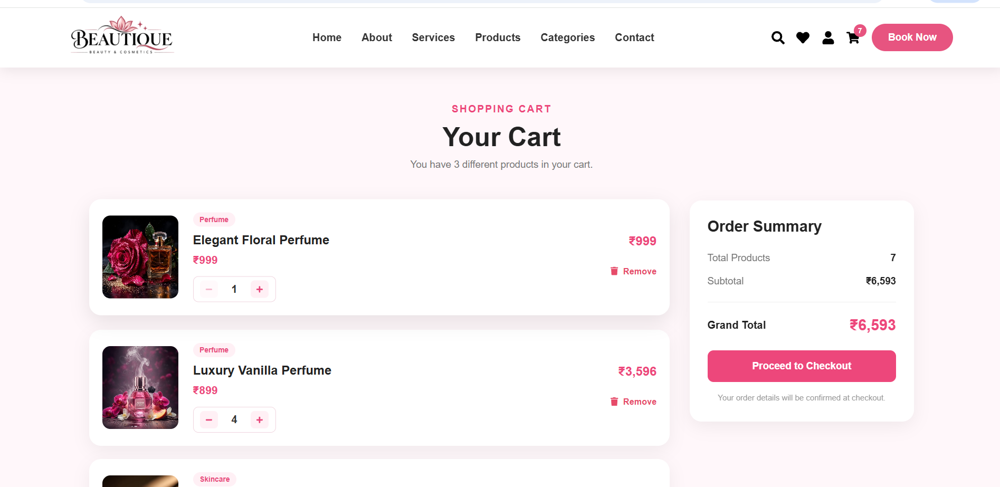
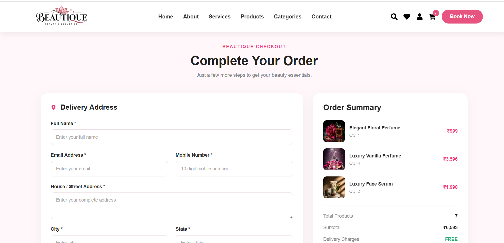
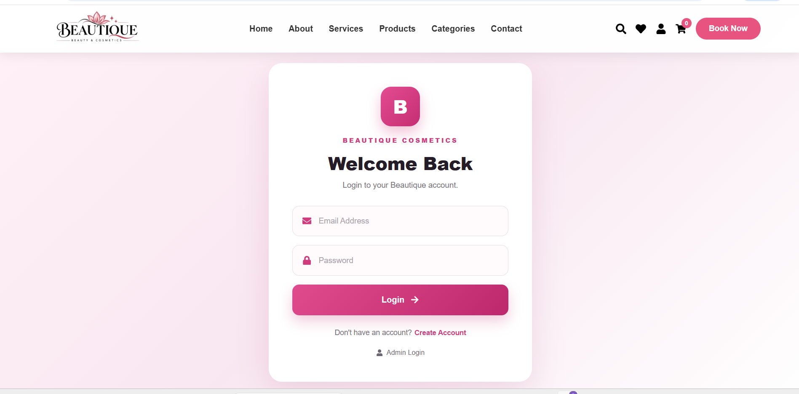
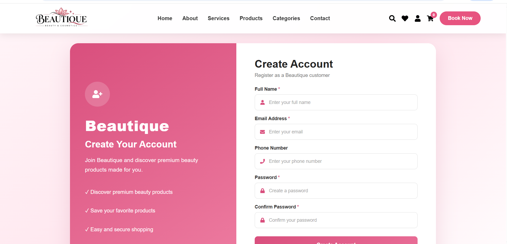
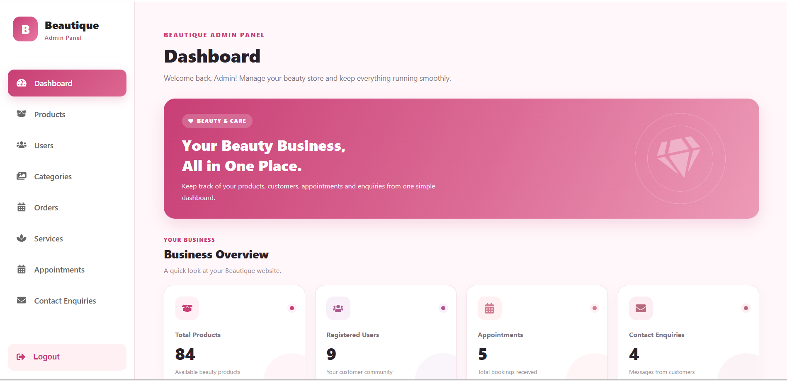
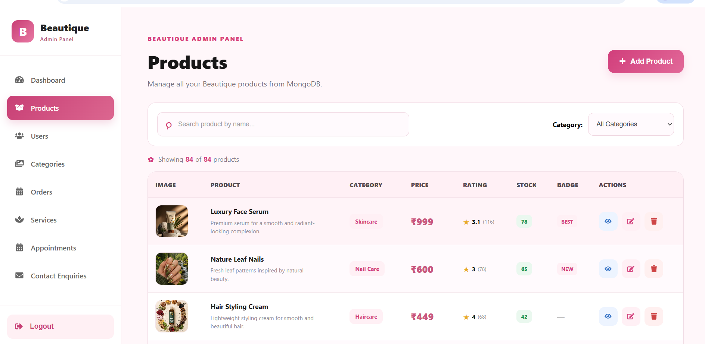
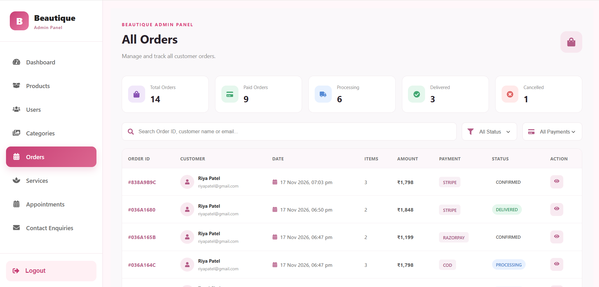
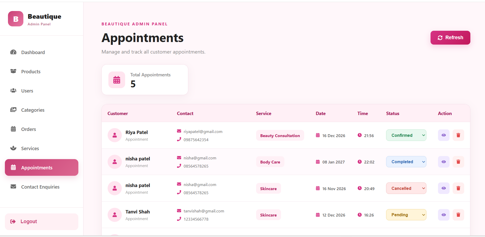

# Beautique – Beauty & Wellness E-Commerce Website

Beautique is a full-stack beauty and wellness e-commerce website where customers can explore beauty products, browse categories, add products to their cart, and place orders using supported payment methods. Customers can also explore available services and book appointments.

The project includes a separate admin panel for managing products, categories, orders, appointments, customers, and other website information.

## Live Demo

**Coming Soon...**

## Features

### Customer Website

- Responsive design for desktop, tablet, and mobile.
- Browse beauty products and product categories.
- View product information and product details.
- Add products to the shopping cart.
- Update quantities and manage cart items.
- Customer registration and login.
- Protected customer features using authentication.
- Checkout using supported payment methods:
  - Cash on Delivery (COD)
  - Razorpay
  - Stripe
- Place orders and view order information.
- Explore beauty and wellness services.
- Book appointments through the website.
- Submit enquiries through the contact form.

### Admin Panel

- Admin authentication.
- Dashboard for viewing store information.
- Add, view, and manage products.
- Manage product categories.
- View customer information.
- View and manage orders and order statuses.
- View and manage appointments.
- Manage website information through the admin panel.

## Screenshots

### Home Page


### Products


### Product Details


### Categories


### Cart and Checkout





### Authentication





### Services and Appointments


### Contact


### Admin Panel









## Tech Stack

### Frontend

- React
- Vite
- JavaScript
- HTML5
- CSS3
- Axios
- React Router
- React Icons

### Backend

- Node.js
- Express.js
- JavaScript
- REST API
- Cookie Parser
- CORS

### Database and Integrations

- MongoDB
- Cloudinary
- Razorpay
- Stripe

## Project Structure

```text
Beautique/
│
├── Backend/
│   ├── config/
│   ├── controllers/
│   ├── middleware/
│   ├── models/
│   ├── routes/
│   ├── .env
│   ├── package.json
│   └── server.js
│
├── Frontend/
│   ├── Client/
│   │   ├── public/
│   │   ├── src/
│   │   ├── .env
│   │   └── package.json
│   │
│   └── Admin/
│       ├── public/
│       ├── src/
│       ├── .env
│       └── package.json
│
├── screenshots/
│   ├── home.png
│   ├── products.png
│   ├── product-details.png
│   ├── categories.png
│   ├── cart.png
│   ├── checkout.png
│   ├── login.png
│   ├── register.png
│   ├── services.png
│   ├── appointments.png
│   ├── contact.png
│   ├── admin-dashboard.png
│   ├── admin-products.png
│   ├── admin-orders.png
│   └── admin-appointments.png
│
└── README.md
```

## Installation and Setup

### 1. Clone the Repository

```bash
https://github.com/Purvakavad/Beautique
cd Beautique
```

### 2. Install Backend Dependencies

```bash
cd Backend
npm install
```

### 3. Configure Backend Environment Variables

Create a `.env` file inside the `Backend` folder. Add the variables required by your backend:

```env
PORT=4000
NODE_ENV=development

MONGO_URI=your_mongodb_connection_string
JWT_SECRET=your_jwt_secret

FRONTEND_URL=http://localhost:5174

CLOUDINARY_CLOUD_NAME=your_cloudinary_cloud_name
CLOUDINARY_API_KEY=your_cloudinary_api_key
CLOUDINARY_API_SECRET=your_cloudinary_api_secret

RAZORPAY_KEY_ID=your_razorpay_key_id
RAZORPAY_KEY_SECRET=your_razorpay_key_secret

STRIPE_SECRET_KEY=your_stripe_secret_key
```

Use the exact variable names referenced in your backend source code. For example, if your database connection uses `MONGOOSE_URL` instead of `MONGODB_URI`, use `MONGOOSE_URL`.


### 4. Start the Backend

```bash
npm run server
```

The backend runs at:

```text
http://localhost:4000
```

### 5. Install and Start the Customer Frontend

Open a new terminal from the project root:

```bash
cd Frontend/Client
npm install
```

Create a `.env` file inside the customer frontend folder:

```env
VITE_BACKEND_URL=http://localhost:4000
```

Start the customer website:

```bash
npm run dev
```

### 6. Install and Start the Admin Frontend

Open another terminal from the project root:

```bash
cd Frontend/Admin
npm install
```

Create a `.env` file inside the admin frontend folder:

```env
VITE_BACKEND_URL=http://localhost:4000
```

Start the admin panel:

```bash
npm run dev
```

## Environment Variables and Security

- Keep `.env` files private and include them in `.gitignore`.
- Never publish MongoDB credentials, JWT secrets, Cloudinary secrets, Razorpay secrets, or Stripe secret keys.
- Use payment gateway test credentials during local development.
- Configure production frontend URLs and backend CORS origins before deployment.
- Do not expose private credentials through frontend environment variables. Vite variables prefixed with `VITE_` are exposed to the browser.

## Payment Integration

Beautique includes the following checkout options:

- **Cash on Delivery (COD):** Customers can place an order without making an online payment.
- **Razorpay:** Online payments through the Razorpay Checkout flow.
- **Stripe:** Online payments through Stripe Checkout.

Configure payment credentials and verification settings in the backend before using online payments.

## API Overview

The backend is organized into REST API route groups:

| Route Prefix | Purpose |
|---|---|
| `/api/auth` | Customer authentication |
| `/api/Product` | Product operations |
| `/api/cart` | Shopping cart operations |
| `/api/order` | Order and payment operations |
| `/api/appointments` | Appointment operations |
| `/api/dashboard` | Dashboard data |
| `/api/admin` | Admin operations |
| `/api/categories` | Product category operations |
| `/api/contacts` | Contact form operations |
| `/api/services` | Beauty and wellness service operations |

The available endpoints and HTTP methods are defined in the backend route files.

## Testing Checklist

- [ ] Customer registration and login
- [ ] Product and category loading
- [ ] Product details display
- [ ] Add products to cart
- [ ] Update cart quantities and remove items
- [ ] Cash on Delivery checkout
- [ ] Razorpay test payment and verification
- [ ] Stripe test payment and verification
- [ ] Order creation and order status updates
- [ ] Services page
- [ ] Appointment booking
- [ ] Contact form submission
- [ ] Admin login and protected routes
- [ ] Product and category management
- [ ] Order management
- [ ] Appointment management
- [ ] Responsive layout on desktop, tablet, and mobile

## Future Enhancements

- Product search, sorting, and advanced filters.
- Product reviews and ratings.
- Email notifications for orders and appointments.
- Improved order tracking.
- More detailed sales and appointment analytics.
- Further accessibility and performance improvements.

## Author

**Purva Kavad**

- GitHub: [Purvakavad](https://github.com/Purvakavad)
- LinkedIn: [purvakavad](https://www.linkedin.com/in/purvakavad/)

## License

This project was developed for learning purposes.
